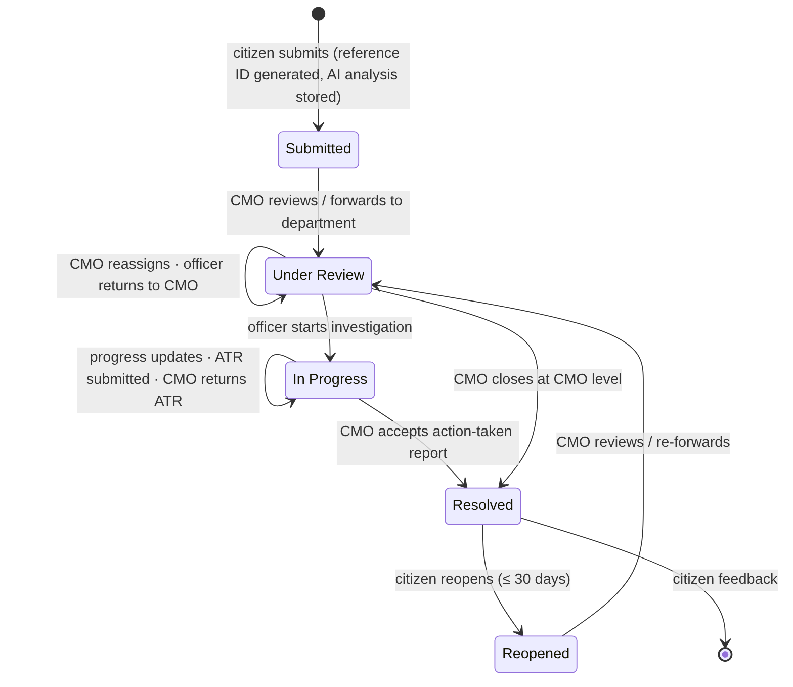

# 01 · Project Overview

> Recruitment prototype — not affiliated with the Government of Kerala or the Chief Minister's Office. All data is fictional.

## Problem statement

Citizens facing problems with public infrastructure, healthcare, education, utilities or other public services often do not know which office is responsible, have no single place to complain, and cannot see what happens after they complain. On the government side, the Chief Minister's Office (CMO) needs to receive grievances directly, route them to the right department quickly, hold departments accountable to timelines, and verify outcomes before telling the citizen the matter is closed.

## Objectives

1. Give citizens **one portal** to submit grievances, receive a **unique reference number**, and **track** status transparently.
2. Let the CMO **review, prioritise and forward** grievances to departments, **monitor** departmental action and **verify** action-taken reports before closure.
3. Give department officers a focused workspace to **investigate, update and report** on grievances assigned to them.
4. Use an **LLM-based AI assistant** to speed up triage — category, department, priority, summary and duplicate detection — while keeping every decision with humans.
5. Keep a **complete, tamper-evident audit trail** of every status change with timestamp and responsible user.
6. Provide **statistics** (district-wise, department-wise, trend, SLA/overdue) for oversight.

## Scope

**In scope (implemented)**

| Area | Features |
|---|---|
| Public website | Home, About Us, How It Works, Departments, Contact Us (stored in DB), FAQ, public Track page |
| Citizen portal | Registration / login / logout, submit with attachments, reference ID, tracking with history, dashboard with counts, official remarks, feedback, reopen |
| CMO dashboard | All grievances with filters & search, KPIs (total/pending/resolved/overdue/escalated), charts & tables by district/department/status/month, forward/reassign to department + officer, internal & public remarks, escalation, ATR review queue, CMO-level closure, reclassification, re-run AI, contact-enquiry inbox |
| Officer dashboard | Department-scoped queue with tabs (new, in progress, ATR returned, awaiting CMO, overdue, resolved), start investigation, progress updates, ATR with document upload, return mis-routed cases to CMO |
| Workflow | Server-enforced state machine with five statuses and full history |
| AI | Live LLM triage (Gemini / OpenAI-compatible / Claude), validated JSON, labelled fallback, TF-IDF duplicate detection, audit log of all AI calls, AI-vs-human agreement metrics |
| Security & quality | RBAC, record-level scoping, input validation, rate limiting, CSP, upload verification, automated tests |

**Out of scope (prototype)** — SMS/email notifications (updates are shown in-portal), Malayalam localisation, OTP verification, admin UI for managing departments/officers (seeded), integration with real government systems.

## Roles

| Role | Can |
|---|---|
| **Citizen** | Register, submit, track, view public remarks, give feedback, reopen |
| **CMO Administrator** | See everything, review, classify, forward, escalate, remark, review ATRs, resolve, view statistics & enquiries |
| **Department Officer** | See only grievances currently assigned to their department; investigate, update, submit ATR, return to CMO |

## Grievance lifecycle

`Citizen submits → reference ID generated → CMO reviews → CMO forwards to department → officer investigates and updates → department submits action-taken report → CMO reviews (accept or return) → citizen sees update → Resolved, or Reopened by citizen.`

## Key design decisions

- **Single deployable service** — Express serves both the REST API and the built React app: one URL, no CORS, simple hosting.
- **Attachments stored in PostgreSQL (`bytea`)** — free hosting tiers have ephemeral disks; storing files with the data keeps uploads durable and transactional (max 5 MB each).
- **AI suggestions never overwrite official fields** — stored in `ai_*` columns and `ai_analyses`; humans accept or override.
- **Non-sequential reference numbers** — prevent enumeration of other citizens' grievances on the public tracker.
- **ATR review as a separate state** (`department_assignments.review_status`) — keeps the five mandated public statuses while still modelling "submitted for CMO review".
