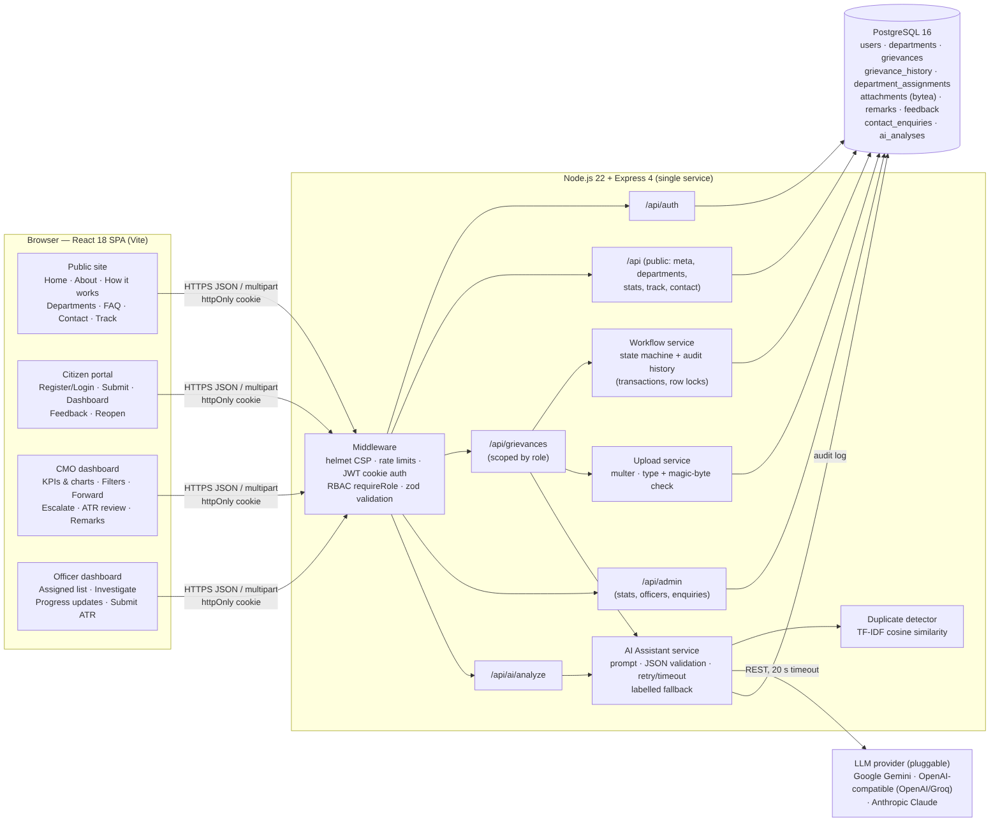

# 02 · System Architecture



(Source: [`diagrams/architecture.mmd`](diagrams/architecture.mmd) — Mermaid.)

## Overview

A three-tier web application deployed as **one Node.js service** plus a **PostgreSQL** database, with an optional external **LLM API**.

```
Browser (React SPA) ──HTTPS/JSON + httpOnly cookie──▶ Express API ──SQL──▶ PostgreSQL
                                                         │
                                                         └──HTTPS──▶ LLM provider (Gemini / OpenAI-compatible / Claude)
```

## Frontend — `client/`

| Concern | Choice |
|---|---|
| Framework | React 18 + Vite 5, React Router 6 (code-split routes per dashboard) |
| State | React context for auth session and reference metadata; local component state elsewhere (no global store needed) |
| Charts | Recharts (line, donut, stacked bar, horizontal bar) |
| Styling | Hand-written CSS design system (`styles.css`): tokens, responsive grid, accessible focus states, mobile navigation |
| API access | `lib/api.js` fetch wrapper (`credentials: 'include'`), field-level validation errors mapped to forms |
| Route guards | `RequireRole` redirects anonymous users to login (returning afterwards) and users of the wrong role to their own home |

Pages: `pages/public/*` (website, track, auth), `pages/citizen/*`, `pages/cmo/*`, `pages/officer/*`, and a single role-aware `GrievanceDetail` that renders different action panels for citizen, CMO and officer.

## Backend — `server/`

| Layer | Files | Responsibility |
|---|---|---|
| App | `app.js`, `index.js` | helmet (CSP), JSON limits, rate limit, auth resolution, routers, static SPA hosting, error handler; migrate + seed on boot |
| Middleware | `middleware/auth.js` | JWT sign/verify (cookie or Bearer), `requireAuth`, `requireRole(...)` |
| | `middleware/errors.js` | `HttpError`, async wrapper, consistent JSON errors (zod → 400 with field details) |
| | `middleware/rateLimits.js` | auth 30/15 min, AI 12/min, contact 10/h, API 300/min per IP |
| Routes | `routes/auth.js` | register, login, logout, me |
| | `routes/public.js` | meta, departments, public stats, public tracker, contact |
| | `routes/grievances.js` | submit, list (role-scoped + filters), summary, detail, attachments, every workflow action |
| | `routes/admin.js` | CMO statistics, officer list, enquiries |
| | `routes/ai.js` | AI analyze, provider status |
| Services | `services/workflow.js` | **State machine.** Each action = one transaction: `SELECT … FOR UPDATE`, validate current status & ownership, update, write `grievance_history` |
| | `services/ai.js` | Provider adapters, prompt, JSON extraction, zod validation, retry/timeout, labelled fallback |
| | `services/aiAssistant.js` | Orchestration: LLM + duplicate search in parallel, persist `ai_analyses` |
| | `services/similarity.js` | TF-IDF + cosine similarity for duplicate flags |
| | `services/uploads.js` | multer memory storage, MIME whitelist, magic-byte verification, SHA-256, DB persistence |
| | `services/reference.js` | `CMK-YY-DIS-XXXXXX` generator (31-symbol alphabet, no ambiguous characters) |
| Data | `db/schema.sql`, `db/seed.js` | Idempotent schema (enums, FKs, checks, partial unique index), deterministic fictional seed |

### Authorisation model

1. **Role check** per route (`requireRole('cmo_admin')`, etc.).
2. **Record scoping** in SQL for every grievance query:
   - citizen → `g.citizen_id = me`
   - officer → `g.department_id = my department` (current assignment only)
   - CMO → all
   Out-of-scope records return **404** (no existence leak).
3. **Field-level redaction** — citizens never receive internal remarks, internal history entries, ATR attachments or officer names; the public tracker returns no personal data.

### Request flow example — officer submits an ATR

1. `POST /api/grievances/:id/atr` (multipart) → rate limiter → `optionalAuth` resolves user from cookie → `requireRole('dept_officer')`.
2. zod validates `report`; multer enforces size/type; `verifyFile` checks magic bytes.
3. In one transaction: save attachment → `workflow.submitAtr` locks the grievance, asserts department ownership, status `In Progress`, and assignment state `awaiting_atr|returned` → sets `pending_review` → writes history.
4. Responds with the refreshed grievance summary; the CMO dashboard's "ATRs awaiting review" count increments.

## AI architecture

See [05_AI_Integration.md](05_AI_Integration.md). In short: `POST /api/ai/analyze` → build prompt with the department catalogue → provider adapter (REST, JSON mode, 20 s timeout, 1 retry) → extract + normalise + zod-validate → in parallel, TF-IDF similarity against the last 180 days of grievances → store in `ai_analyses` → return suggestions. On submission the reviewed analysis is linked to the grievance (or re-run if the text changed).

## Deployment

- **Render Blueprint** (`render.yaml`): free web service + free PostgreSQL; `npm run build` builds the SPA, `npm start` runs Express which serves `client/dist` and `/api`.
- **Docker** (`Dockerfile`, `docker-compose.yml`) for local or container hosting.
- Schema migration and demo seeding run automatically at startup (idempotent).
