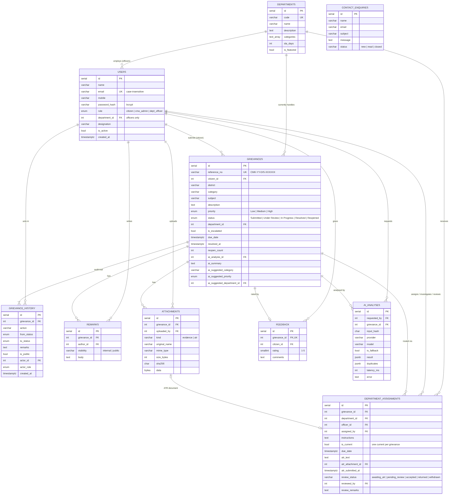

# 03 · Database Design

**Engine:** PostgreSQL 16 (works on ≥ 12). **Schema:** [`server/src/db/schema.sql`](../server/src/db/schema.sql) — idempotent, applied automatically at startup.



(Source: [`diagrams/er-diagram.mmd`](diagrams/er-diagram.mmd).)

## Enumerated types

| Type | Values |
|---|---|
| `user_role` | `citizen`, `cmo_admin`, `dept_officer` |
| `grievance_status` | `Submitted`, `Under Review`, `In Progress`, `Resolved`, `Reopened` |
| `priority_level` | `Low`, `Medium`, `High` |

## Entities

### `users` — citizens, CMO administrators, department officers
| Column | Type | Notes |
|---|---|---|
| id | serial PK | |
| name, mobile | varchar | mobile normalised to 10 digits |
| email | varchar | unique index on `lower(email)` |
| password_hash | varchar | bcrypt (cost 10) |
| role | user_role | |
| department_id | FK → departments | **CHECK**: required when role = `dept_officer` |
| designation, is_active, last_login_at, created_at | | |

### `departments`
`id`, `code` (unique, e.g. `WRD`), `name`, `description`, `icon`, `categories text[]` (categories usually handled — used by the AI prompt), `sla_days` (target resolution time), `is_featured`.

### `grievances`
| Column | Notes |
|---|---|
| reference_no | unique, `CMK-YY-<district code>-<6 random>` |
| citizen_id | FK → users (RESTRICT delete) |
| district, category, subject, description | citizen input (validated against fixed lists) |
| priority, status | official values set by humans |
| department_id | **current** department (denormalised for fast scoping/filters) |
| is_escalated, escalated_at | |
| due_date | SLA target; `overdue = status <> 'Resolved' AND due_date < now()` |
| resolved_at, reopen_count | |
| ai_analysis_id, ai_summary, ai_suggested_category, ai_suggested_priority, ai_suggested_department_id, ai_category_accepted | **AI suggestions kept separate from official fields** |
| created_at, updated_at | |

Indexes: citizen, status, department, district, created_at.

### `grievance_history` — audit trail
One row per action: `action` (submitted, reviewed, forwarded, reassigned, investigation_started, progress_update, atr_submitted, atr_returned, resolved, reopened, escalated, feedback, remark, returned_to_cmo, updated), `from_status`, `to_status`, `remarks`, `is_public` (shown to citizen/public tracker?), `actor_id`, `actor_role`, `created_at`. Every status change is recorded here with timestamp and responsible user.

### `department_assignments` — routing + action-taken reports
| Column | Notes |
|---|---|
| grievance_id, department_id, officer_id (optional), assigned_by, instructions, assigned_at, due_date | |
| is_current | **partial unique index** guarantees at most one current assignment per grievance |
| atr_text, atr_attachment_id, atr_submitted_by, atr_submitted_at | action-taken report |
| review_status | `awaiting_atr` → `pending_review` → `accepted` / `returned`; `withdrawn` on reassignment |
| reviewed_by, reviewed_at, review_remarks | CMO decision |

Keeping *all* assignments (not just the latest) preserves the history of reassignments and returned reports.

### `attachments`
`grievance_id`, `uploaded_by`, `kind` (`evidence` from citizen, `atr` from officer), `original_name` (sanitised), `mime_type`, `size_bytes`, `sha256`, `data bytea`. Stored in the database so files survive stateless hosting and are covered by the same access checks and transactions.

### `remarks`
`grievance_id`, `author_id`, `author_role`, `visibility` (`internal` = CMO/department only, `public` = shown to citizen), `body`.

### `feedback`
One per grievance (`UNIQUE grievance_id`), `rating` 1–5 (CHECK), `comments`. Deleted if the citizen reopens, so they can rate the new outcome.

### `contact_enquiries`
`name`, `email`, `subject`, `message`, `status` (`new`/`read`/`closed`).

### `ai_analyses` — AI audit log
`requested_by`, `grievance_id` (linked on submission), `input_hash` (SHA-256 of subject+description+district — used to confirm the citizen reviewed suggestions for the exact text submitted), `provider`, `model`, `is_fallback`, `result jsonb`, `duplicates jsonb`, `latency_ms`, `error`.

## Relationships (summary)

- `departments 1—* users` (officers) · `departments 1—* grievances` (current) · `departments 1—* department_assignments`
- `users 1—* grievances` (citizen) · `users 1—* grievance_history / remarks / attachments / feedback / ai_analyses` (actor/author)
- `grievances 1—* grievance_history, department_assignments, attachments, remarks, ai_analyses` · `grievances 1—0..1 feedback`
- `department_assignments 0..1—0..1 attachments` (ATR document)

## Integrity & consistency

- Foreign keys everywhere; `ON DELETE CASCADE` for child rows of a grievance, `RESTRICT` for a citizen with grievances.
- CHECK constraints for ratings, officer–department requirement, enum-like varchar columns.
- All workflow mutations run in a transaction with `SELECT … FOR UPDATE` on the grievance row, so concurrent actions (e.g. two admins) cannot produce an inconsistent state.

## Sample data

`server/src/db/seed.js` creates **fictional** data with a deterministic random generator: 14 departments, 2 CMO admins, 14 officers (one per department), 8 citizens, 56 grievances spread across districts and every workflow stage (with matching history, assignments, ATRs, remarks, feedback, a reopened case, a returned ATR and escalations), and 2 contact enquiries.

```bash
npm run seed         # seed only if empty
npm run seed:reset   # wipe and reseed
```
