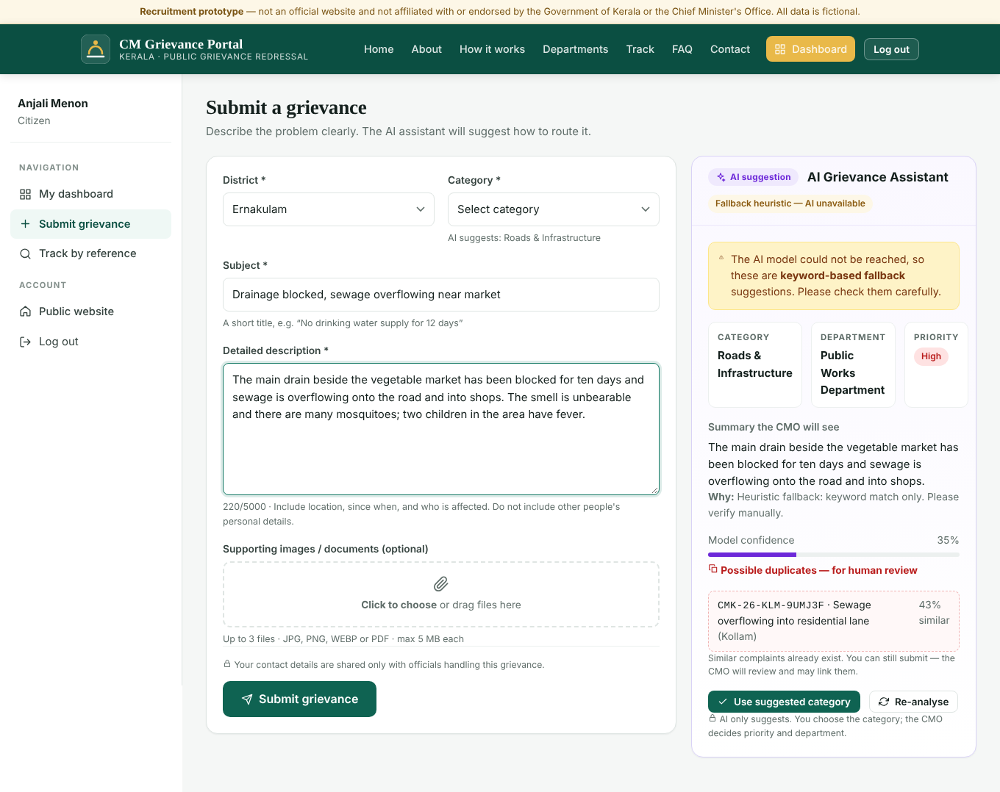
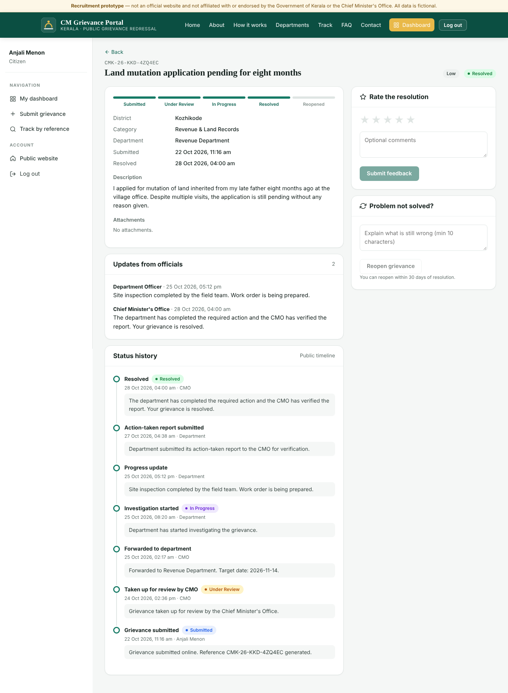
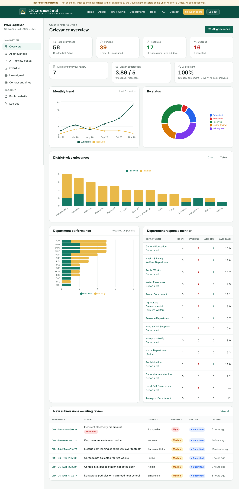
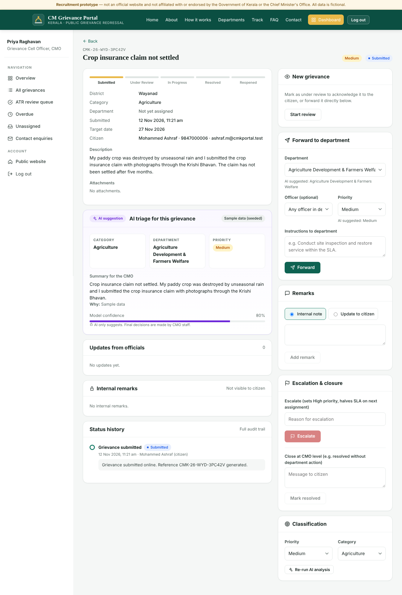
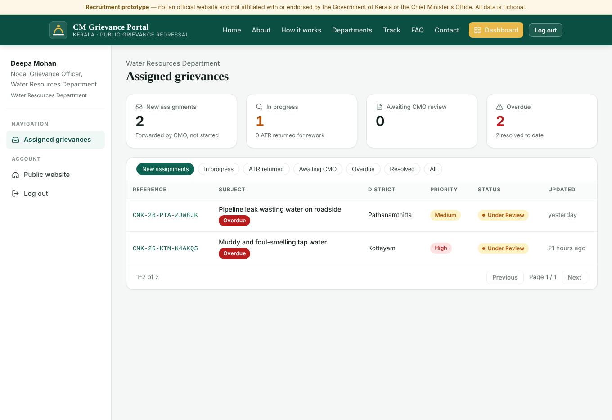
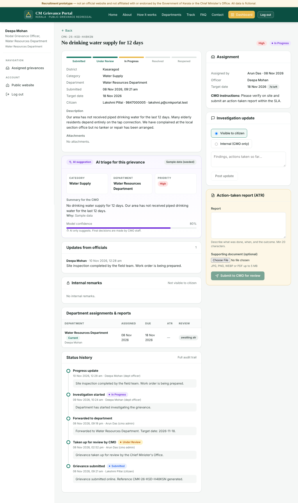

# 07 · User Guide

> Use the demo accounts in the [README](../README.md#demo-login-credentials-test-accounts-only), or the one-click buttons on the login page. All data is fictional.

---

## A. Citizens

### 1. Create an account / log in
*Register* (top right → *Log in* → *Create an account*): enter name, email, 10-digit mobile number and a password (8+ characters with letters and numbers). You are logged in immediately. Use *Log out* in the header or sidebar to end the session.

### 2. Submit a grievance
*Submit grievance* (header or dashboard).

1. Choose your **district** and a **category**.
2. Write a short **subject** and a **detailed description** — where, since when, who is affected.
3. Optionally attach up to **3 photos or PDFs** (≤ 5 MB each) by clicking or dragging into the box.
4. The **AI Grievance Assistant** panel on the right analyses your text after you pause typing (or click *Analyse my complaint*). It shows a suggested category, department and priority, a summary the CMO will see, and any similar complaints already filed.
   - Click **Use suggested category** to accept it, or keep your own choice.
   - If you edit the text later, click **Re-analyse**.
   - The AI only suggests — CMO officials decide priority and department.
5. Click **Submit grievance**. Your **reference number** (e.g. `CMK-26-TVM-7K3F9Q`) is displayed — copy it.

### 3. Track progress
- **Without logging in:** *Track* in the header → enter the reference number. You see status, assigned department, target date and the public timeline.
- **From your dashboard:** *My dashboard* shows totals (submitted, pending, resolved, reopened) and a list you can filter by status. Click any row for full details, including **Updates from officials**.

Statuses: **Submitted** → **Under Review** (CMO reviewing / assigned to a department) → **In Progress** (department working) → **Resolved**. **Reopened** means you reported it is not fixed.

### 4. After resolution
Open the grievance:
- **Rate the resolution** (1–5 stars, optional comment).
- **Problem not solved?** Explain why and click *Reopen grievance* (within 30 days). It goes back to the CMO.

---

## B. CMO administrators

Log in as `admin@cmkportal.test` → **Overview**.

### 1. Overview dashboard
- KPI tiles: **Total, Pending, Resolved, Overdue** (click to open the filtered list), **ATRs awaiting review**, **citizen satisfaction**, **AI agreement**.
- Charts: monthly submitted vs resolved, status breakdown, **district-wise** stacked bars (toggle to table), **department-wise** performance and a **department response monitor** (open, overdue, ATRs due, average resolution days).
- *New submissions awaiting review* list.

### 2. Find grievances
*All grievances*: search by reference or subject; filter by **status, district, category, priority, department**; quick chips for **Overdue, Escalated, ATR awaiting review, Unassigned**; sort by newest, priority, due date, etc. Sidebar shortcuts open the ATR queue, overdue and unassigned lists directly.

### 3. Review and forward
Open a grievance. On the left: details, citizen contact, attachments (click to view), **AI triage panel** (suggested category/department/priority, summary, possible duplicates with links), remarks and the full audit trail. On the right:

1. **Start review** — marks it *Under Review* (acknowledges the citizen).
2. **Forward to department** — the AI-suggested department is pre-selected and marked **✦ AI**, and the AI priority is pre-filled; change them if needed, optionally pick a specific **officer** (open-case counts shown) and add **instructions**. Click *Forward*. A target date is set from the department's SLA.
3. **Remarks** — *Internal note* (staff only) or *Update to citizen*.
4. **Escalation & closure** — escalate delayed grievances with a reason (priority becomes High, SLA halved on next assignment); or close directly at CMO level with a message.
5. **Classification** — change priority/category; *Re-run AI analysis*.

### 4. Review action-taken reports
*ATR review queue* → open a grievance. The highlighted panel shows the department's report and attachment.
- **Accept & resolve** — optionally write the message the citizen will see. Status → *Resolved*.
- **Return to department** — remarks are required; the officer sees them and must resubmit.

### 5. Contact enquiries
*Contact enquiries* lists messages from the public Contact page; mark them *Read* or *Closed*.

---

## C. Department officers

Log in as e.g. `wrd.officer@cmkportal.test` (Water Resources). You only see grievances currently assigned to **your department**.

### 1. Your queue
Tiles show new assignments, in-progress, awaiting CMO review and overdue. Tabs: **New assignments, In progress, ATR returned, Awaiting CMO, Overdue, Resolved, All** (sorted by due date).

### 2. Work a grievance
1. Open it and read the details, attachments and **CMO instructions**; the assignment card shows the target date and days left/overdue.
2. Click **Start investigation** (optional note to the citizen). Status → *In Progress*.
   - Wrong department? Enter a reason and **Return to CMO**.
3. Post **investigation updates** — *Visible to citizen* or *Internal (CMO only)*.
4. Fill in the **Action-taken report**: what was done, when and the outcome; attach a supporting photo/PDF if available. Click **Submit to CMO for review**.
5. If the CMO returns the report, a yellow banner shows their remarks — update and resubmit.

---

## D. Public visitors

- **Home** — introduction, live statistics, Submit/Track buttons, featured departments.
- **About**, **How it works**, **Departments**, **FAQ** — information pages.
- **Contact** — send an enquiry (saved for the helpdesk).
- **Track** — check any grievance by reference number; no personal data is shown.
